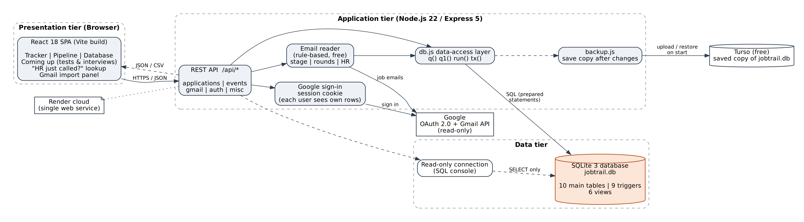
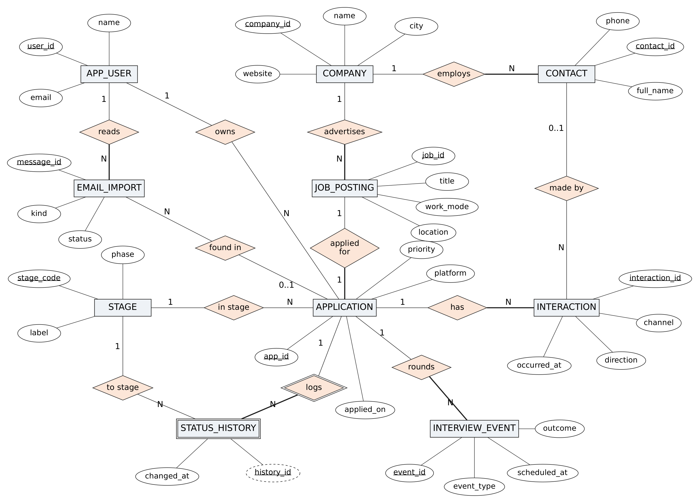
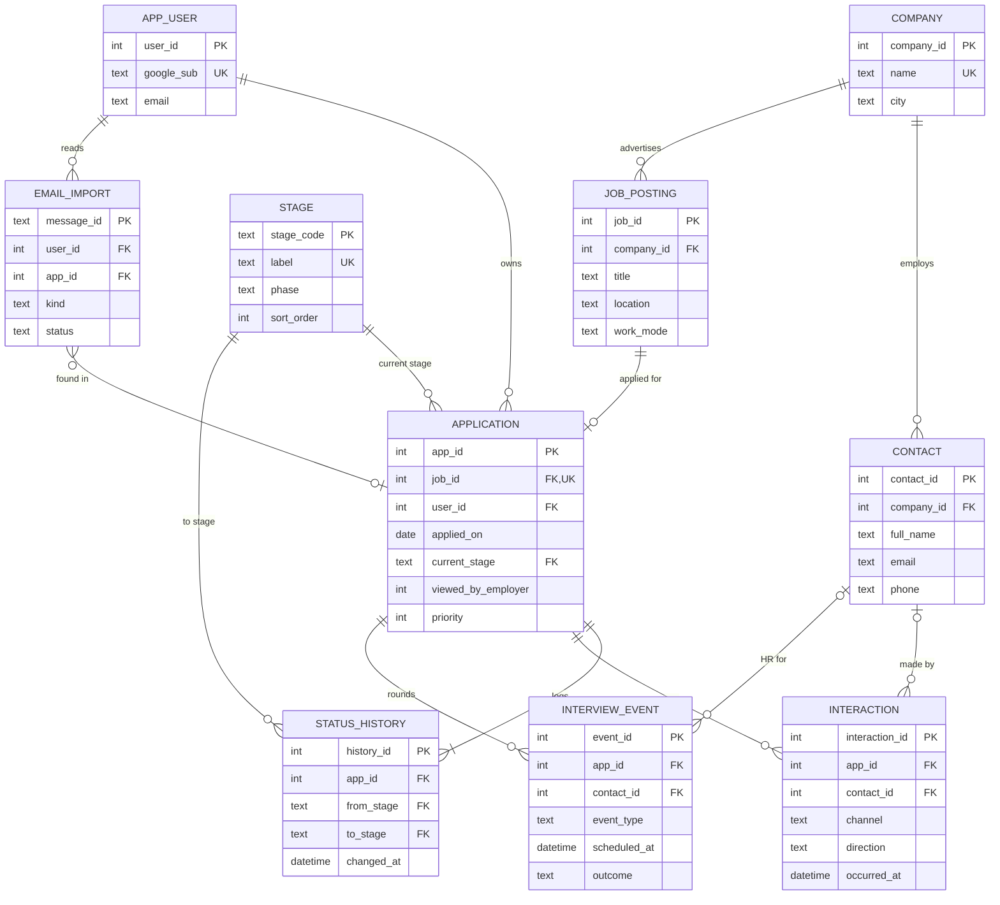

# JobTrail — database design

Everything about the database in one place: the ER diagram, every table and column, the keys and
constraints, indexes, views, triggers, transactions, and the queries behind each button in the app.
The live data can also be browsed in Turso (see the last section).

| File | What it holds |
| --- | --- |
| `database/schema.sql` | The 7 core tables, indexes, 5 views and 6 triggers |
| `database/gmail.sql` | Users, Gmail import and interview rounds: 3 more tables, 3 triggers, `v_upcoming_events` |
| `database/seed.sql` | 8 sample applications (shown when nobody is signed in) |
| `database/queries.sql` | Every query the app runs to show your data, plus handy viva queries |
| `database/mysql-reference/` | The same design for MySQL 8, with stored procedures |
| `backend/src/db.js` | Opens SQLite, runs the schema, and the `tx()` transaction helper |
| `backend/src/routes/reports.js` | The fixed, per-user queries behind the Database tab |

Engine: **SQLite 3**, built into Node.js 22. The whole database is one file, `database/jobtrail.db`.
On Render a copy is kept in **Turso** so nothing is lost when the server restarts.

---

## 1. Architecture



React (browser) → Express REST API (Node.js) → SQLite. The server also signs users in with Google,
reads job emails through the Gmail API (read-only), and saves a copy of the database to Turso.

---

## 2. ER diagram



Chen notation: rectangles are entities, ellipses attributes (underlined = key), diamonds
relationships. A thick line means total participation; a double rectangle is a weak entity.

The same diagram as Mermaid (GitHub draws it; in VS Code install the *Markdown Preview Mermaid
Support* extension, then open this file and press **Cmd + Shift + V**):



### Relationships and how they became tables

| Relationship | Cardinality | Implemented as |
| --- | --- | --- |
| Company employs Contact | 1 : N | `contact.company_id` FK |
| Company advertises Job posting | 1 : N | `job_posting.company_id` FK |
| Job posting applied for by Application | 1 : 1 | `application.job_id` FK **and UNIQUE** |
| Stage holds Application | 1 : N | `application.current_stage` FK |
| Application logs Status history (weak entity) | 1 : N | `status_history.app_id` FK, ON DELETE CASCADE |
| Application has Interaction | 1 : N | `interaction.app_id` FK |
| Contact makes Interaction | 0..1 : N | `interaction.contact_id` FK, ON DELETE SET NULL |
| App user owns Application / Contact | 1 : N | `application.user_id`, `contact.user_id` FK |
| App user reads Email import | 1 : N | `email_import.user_id` FK |
| Application has rounds (Interview event) | 1 : N | `interview_event.app_id` FK |

Rule used: the primary key of the "one" side becomes a foreign key in the "many" side; for 1:1 the
foreign key is also UNIQUE. There is no M:N relationship, so no junction table is needed.

---

## 3. Normalization

All tables are in **BCNF**: in every table, every determinant is a candidate key.

- **1NF** — one value per cell: several recruiters or calls are separate rows in `contact` and `interaction`.
- **2NF** — every table has a single-column key, so no partial dependency is possible.
- **3NF** — no transitive dependency: a company's city lives in `company`, not in each application;
  a stage's label and phase live in the `stage` lookup table, not in each application.
- **BCNF** — the only determinants are keys: `company_id → name, city…` and `name → company_id`
  (name is UNIQUE, a candidate key); `job_id → app_id` (job_id is UNIQUE in application).

One deliberate copy: `email_import` keeps the company and role text exactly as the email said, as a
log; the real company row lives in `company`.

---

## 4. Tables and columns

Ten main tables (the first ten below) plus three small helper tables.

### company

| Column | Type | Rules |
| --- | --- | --- |
| company_id | INTEGER | PK |
| name | TEXT | UNIQUE, NOT NULL |
| website | TEXT |  |
| industry | TEXT |  |
| address | TEXT |  |
| city | TEXT |  |
| country | TEXT | DEFAULT 'India' |
| linkedin_url | TEXT |  |
| created_at | TEXT | NOT NULL, DEFAULT datetime('now','localtime') |

### contact

| Column | Type | Rules |
| --- | --- | --- |
| contact_id | INTEGER | PK |
| company_id | INTEGER | FK → company(company_id) ON DELETE CASCADE, NOT NULL |
| full_name | TEXT | NOT NULL |
| role_title | TEXT |  |
| email | TEXT |  |
| phone | TEXT |  |
| linkedin_url | TEXT |  |
| user_id | INTEGER | FK → app_user(user_id) ON DELETE CASCADE |

### job_posting

| Column | Type | Rules |
| --- | --- | --- |
| job_id | INTEGER | PK |
| company_id | INTEGER | FK → company(company_id) ON DELETE CASCADE, NOT NULL |
| title | TEXT | NOT NULL |
| location | TEXT |  |
| work_mode | TEXT |  |
| employment_type | TEXT |  |
| job_url | TEXT |  |
| external_job_id | TEXT |  |
| salary_text | TEXT |  |
| description | TEXT |  |

### application

| Column | Type | Rules |
| --- | --- | --- |
| app_id | INTEGER | PK |
| job_id | INTEGER | FK → job_posting(job_id) ON DELETE CASCADE, UNIQUE, NOT NULL |
| applied_on | TEXT | NOT NULL |
| platform | TEXT | NOT NULL, DEFAULT 'LinkedIn Easy Apply' |
| resume_version | TEXT |  |
| current_stage | TEXT | FK → stage(stage_code), NOT NULL, DEFAULT 'APPLIED' |
| viewed_by_employer | INTEGER | NOT NULL, DEFAULT 0 |
| priority | INTEGER |  |
| review | TEXT |  |
| created_at | TEXT | NOT NULL, DEFAULT datetime('now','localtime') |
| last_updated | TEXT | NOT NULL, DEFAULT datetime('now','localtime') |
| source | TEXT | NOT NULL, DEFAULT 'Manual' |
| user_id | INTEGER | FK → app_user(user_id) ON DELETE CASCADE |

### stage

| Column | Type | Rules |
| --- | --- | --- |
| stage_code | TEXT | PK |
| label | TEXT | UNIQUE, NOT NULL |
| phase | TEXT | NOT NULL |
| sort_order | INTEGER | UNIQUE, NOT NULL |
| is_terminal | INTEGER | NOT NULL, DEFAULT 0 |

### status_history

| Column | Type | Rules |
| --- | --- | --- |
| history_id | INTEGER | PK |
| app_id | INTEGER | FK → application(app_id) ON DELETE CASCADE, NOT NULL |
| from_stage | TEXT | FK → stage(stage_code) |
| to_stage | TEXT | FK → stage(stage_code), NOT NULL |
| changed_at | TEXT | NOT NULL, DEFAULT datetime('now','localtime') |

### interaction

| Column | Type | Rules |
| --- | --- | --- |
| interaction_id | INTEGER | PK |
| app_id | INTEGER | FK → application(app_id) ON DELETE CASCADE, NOT NULL |
| contact_id | INTEGER | FK → contact(contact_id) ON DELETE SET NULL |
| channel | TEXT | NOT NULL |
| direction | TEXT | NOT NULL |
| occurred_at | TEXT | NOT NULL |
| summary | TEXT |  |

### app_user

| Column | Type | Rules |
| --- | --- | --- |
| user_id | INTEGER | PK |
| google_sub | TEXT | UNIQUE, NOT NULL |
| email | TEXT | NOT NULL |
| name | TEXT |  |
| refresh_token | TEXT |  |
| access_token | TEXT |  |
| token_expires | INTEGER |  |
| last_sync_at | TEXT |  |
| created_at | TEXT | NOT NULL, DEFAULT datetime('now','localtime') |

### email_import

| Column | Type | Rules |
| --- | --- | --- |
| message_id | TEXT | PK |
| user_id | INTEGER | FK → app_user(user_id) ON DELETE SET NULL |
| received_at | TEXT |  |
| sender | TEXT |  |
| subject | TEXT |  |
| snippet | TEXT |  |
| platform | TEXT |  |
| kind | TEXT | NOT NULL |
| company | TEXT |  |
| role | TEXT |  |
| location | TEXT |  |
| job_url | TEXT |  |
| status | TEXT | NOT NULL |
| app_id | INTEGER | FK → application(app_id) ON DELETE SET NULL |
| event_id | INTEGER | FK → interview_event(event_id) ON DELETE SET NULL |
| processed_at | TEXT | NOT NULL, DEFAULT datetime('now','localtime') |

### interview_event

| Column | Type | Rules |
| --- | --- | --- |
| event_id | INTEGER | PK |
| app_id | INTEGER | FK → application(app_id) ON DELETE CASCADE, NOT NULL |
| user_id | INTEGER | FK → app_user(user_id) ON DELETE CASCADE |
| event_type | TEXT | NOT NULL |
| round_name | TEXT | NOT NULL |
| scheduled_at | TEXT |  |
| has_time | INTEGER | NOT NULL, DEFAULT 1 |
| ends_at | TEXT |  |
| due_by | TEXT |  |
| mode | TEXT |  |
| meeting_link | TEXT |  |
| location | TEXT |  |
| contact_id | INTEGER | FK → contact(contact_id) ON DELETE SET NULL |
| outcome | TEXT | NOT NULL, DEFAULT 'Scheduled' |
| source | TEXT | NOT NULL, DEFAULT 'Gmail' |
| source_message_id | TEXT | UNIQUE |
| created_at | TEXT | NOT NULL, DEFAULT datetime('now','localtime') |

### user_session

| Column | Type | Rules |
| --- | --- | --- |
| session_id | TEXT | PK |
| user_id | INTEGER | FK → app_user(user_id) ON DELETE CASCADE, NOT NULL |
| created_at | TEXT | NOT NULL, DEFAULT datetime('now','localtime') |

### app_clock

| Column | Type | Rules |
| --- | --- | --- |
| id | INTEGER | PK |
| event_at | TEXT |  |

### app_meta

| Column | Type | Rules |
| --- | --- | --- |
| key | TEXT | PK |
| value | TEXT |  |


`user_session` holds login cookies, `app_clock` (one row) lets history triggers use the email's date
during a Gmail sync, and `app_meta` stores one-time setup flags.

### CHECK constraints

| Table | Rule |
| --- | --- |
| stage | `phase IN ('Waiting','Active','Won','Closed')`, `is_terminal IN (0,1)` |
| contact | `email IS NULL OR email LIKE '%_@_%._%'` |
| job_posting | `work_mode IN ('On-site','Hybrid','Remote')`, `employment_type IN ('Full-time','Part-time','Contract','Internship')` |
| application | `date(applied_on) IS NOT NULL`, `platform IN (…6 values)`, `viewed_by_employer IN (0,1)`, `priority BETWEEN 1 AND 5`, `source IN ('Manual','Gmail')` |
| interaction | `channel IN ('Phone call','Email','LinkedIn message','Video call','In person')`, `direction IN ('Inbound','Outbound')`, `datetime(occurred_at) IS NOT NULL` |
| email_import | `kind IN ('applied','viewed','test','interview','offer','rejected','other')`, `status IN ('imported','updated','duplicate','review','ignored')` |
| interview_event | `event_type IN ('Test','Interview','HR round','Assignment')`, `mode IN ('Online','In person','Phone')`, `outcome IN ('Scheduled','Done','Passed','Not selected','Cancelled')`, and the table rule `ends_at >= scheduled_at` |
| app_clock | `id = 1` (exactly one row) |

`company.name` uses `COLLATE NOCASE`, so "Flipkart" and "flipkart" are the same company.
SQLite enforces foreign keys only after `PRAGMA foreign_keys = ON`, which the backend runs on every start.

---

## 5. Indexes (11)

| Index | On | Speeds up |
| --- | --- | --- |
| idx_app_stage | application(current_stage) | Pipeline counts, filter by stage |
| idx_app_applied_on | application(applied_on) | Newest first, monthly report |
| idx_job_company | job_posting(company_id) | Company → postings join |
| idx_contact_company | contact(company_id) | Company → recruiters join |
| idx_int_app_when | interaction(app_id, occurred_at) | Timeline of one application |
| idx_hist_app_when | status_history(app_id, changed_at) | Stage history of one application |
| idx_app_user | application(user_id) | Filtering by the signed-in user |
| idx_contact_user | contact(user_id) | Filtering by the signed-in user |
| idx_event_app | interview_event(app_id) | Rounds of one application |
| idx_event_when | interview_event(user_id, scheduled_at) | "Coming up", sorted by date |
| idx_import_status | email_import(status) | "Check these emails" list |

Proof: `EXPLAIN QUERY PLAN SELECT * FROM application WHERE current_stage = 'APPLIED';`
→ `SEARCH application USING INDEX idx_app_stage (current_stage=?)`.

---

## 6. Views (6)

| View | Used for |
| --- | --- |
| v_application_overview | Tracker table and most reports: company, role, days since applied, stage, viewed, HR called, HR contact |
| v_pipeline | Pipeline: applications per stage |
| v_followups_due | Open, 7+ days old, no contact for 7 days |
| v_monthly_activity | Applied / got a response / reached interview, per month |
| v_company_summary | Every role applied for at one company |
| v_upcoming_events | "Coming up": scheduled tests and interviews with HR details |

---

## 7. Triggers (9)

| Trigger | Fires | Does |
| --- | --- | --- |
| trg_app_created | AFTER INSERT ON application | First history row (NULL → Applied) |
| trg_stage_changed | AFTER UPDATE OF current_stage | Logs old → new in status_history, updates last_updated |
| trg_app_mark_viewed | AFTER UPDATE OF current_stage | Past "Applied" → viewed_by_employer = 1 |
| trg_inbound_contact | AFTER INSERT ON interaction | Inbound call/email while waiting → "HR / recruiter screen" |
| trg_history_readonly | BEFORE UPDATE ON status_history | `RAISE(ABORT, 'status_history is append-only')` |
| trg_cleanup_company | AFTER DELETE ON job_posting | Removes a company left with no postings |
| trg_event_advances_stage | AFTER INSERT ON interview_event | Test → Assessment, interview → Technical interview, HR round → Final (never backwards) |
| trg_close_rounds_on_rejection | AFTER UPDATE OF current_stage | Rejected → open rounds "Not selected"; Withdrawn → "Cancelled" |
| trg_rounds_passed_on_offer | AFTER UPDATE OF current_stage | Offer → earlier rounds "Passed" |

One insert can start a chain: a new `interview_event` row → `trg_event_advances_stage` updates the
application → `trg_stage_changed` writes history and `trg_app_mark_viewed` ticks "viewed".

```sql
CREATE TRIGGER trg_event_advances_stage AFTER INSERT ON interview_event
BEGIN
  UPDATE application
     SET current_stage = CASE NEW.event_type WHEN 'Test' THEN 'ASSESS' WHEN 'Assignment' THEN 'ASSESS'
                                             WHEN 'HR round' THEN 'FINAL' ELSE 'INTERVIEW' END
   WHERE app_id = NEW.app_id
     AND (SELECT is_terminal FROM stage WHERE stage_code = application.current_stage) = 0
     AND (SELECT sort_order FROM stage WHERE stage_code = application.current_stage)
       < (SELECT sort_order FROM stage WHERE stage_code =
            CASE NEW.event_type WHEN 'Test' THEN 'ASSESS' WHEN 'Assignment' THEN 'ASSESS'
                                WHEN 'HR round' THEN 'FINAL' ELSE 'INTERVIEW' END);
END;
```

---

## 8. Transactions (ACID)

Logging an application writes to `company`, `job_posting`, `application` (and `contact`) inside one
transaction (`tx()` in `backend/src/db.js`): `BEGIN` … `COMMIT`, or `ROLLBACK` if any insert fails, so
there is never a posting without its application.

| Property | How |
| --- | --- |
| Atomicity | BEGIN / COMMIT / ROLLBACK in `tx()` |
| Consistency | Constraints and triggers are checked inside the transaction |
| Isolation | SQLite write lock; WAL mode lets readers see the last committed data |
| Durability | Committed data is in the WAL file on disk, and copied to Turso |

---

## 9. Multi-user and security

- Every `application` and `contact` row has `user_id`; every query adds `WHERE user_id IS ?` with the
  id from the server-side session, so people never see each other's rows. `user_id IS NULL` is the demo data.
- Prepared statements (`?` placeholders) everywhere, so SQL injection is not possible.
- Gmail access is read-only. Google tokens stay on the server and are **not** copied to Turso's readable tables.

---

## 10. The queries behind the Database tab

Users click a button and see a table; they never type SQL. Each button runs a fixed query from
`backend/src/routes/reports.js`, filtered to the signed-in user. All of them, with comments, are in
**`database/queries.sql`**: All applications, Overview, Who called me?, Tests & interviews,
Follow up these, Response rate by site, Days to first call, Same company many roles, Stage history,
Recruiters, Emails read. Every view can be downloaded as CSV (`/api/reports/<name>.csv`).

---

## 11. Seeing the live database in Turso

After every change the server saves two things to Turso:

1. **A packed copy** (`jobtrail_snapshot`), which is what gets restored when Render restarts.
2. **A readable copy**: the same tables, views, triggers and indexes with all rows (sign-in tokens
   blanked, login sessions left out).

To look at it: open [app.turso.tech](https://app.turso.tech) → your `jobtrail` database →
**Edit Data** to browse any table (application, company, interview_event, app_user …), or the
**SQL shell** to run anything from `database/queries.sql` (replace `user_id IS ?` with
`user_id IS NULL` for the sample data, or a real user's id).

The readable copy is for looking only: it is rebuilt from the app after every change, so edits made
directly in Turso are overwritten. Change data through the app.
